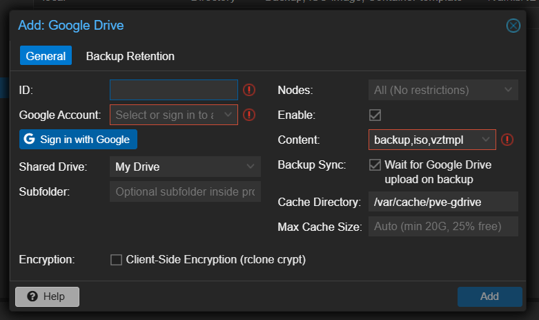
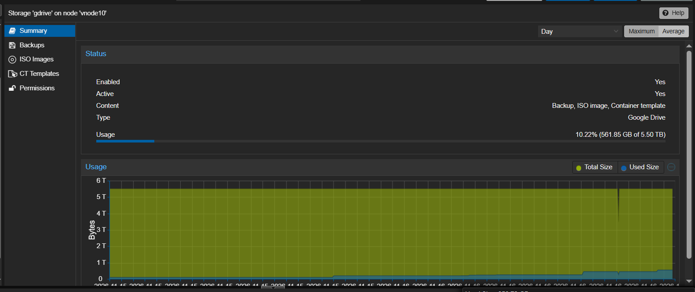
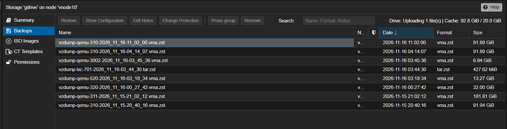

# Proxmox Google Drive Adapter

> **Native Google Drive storage backend (`pve-storage-gdrive`) for Proxmox VE 8.x & 9.x** — mount Google **My Drive** or **Shared Drives** as a first-class Proxmox storage target for `vzdump` backups, ISO images, and LXC container templates.

---

## Highlights & Key Features

- **Native Proxmox VE Integration** — Appears directly under **Datacenter -> Storage -> Add -> Google Drive** with full `pvesm`, Web UI Summary, Backups, ISO Images, and CT Templates support.
- **One-Time Easy Google Sign-In** — Log in once via `pve-gdrive login` or the Web UI **Sign in with Google** wizard. No Google Cloud project, IAM roles, or Service Account JSON setup required *(Service Accounts and `rclone authorize` tokens are still supported for power users)*.
- **My Drive, Shared Drives & Pinned Folders** — Target **My Drive** or any **Shared Drive** with optional subfolder isolation. Folder IDs are pinned on initialization so duplicate `proxmox/` folders are never created.
- **Client-Side Encryption (`rclone crypt`)** — Optional zero-knowledge filename and payload encryption before files ever leave your Proxmox node.
- **Synchronous `vzdump` Upload Verification** — `vzdump-gdrive-hook.pl` waits for `rclone` to finish uploading each backup to Google Drive and fails loudly if an upload errors or times out.
- **Write Speed Throttling & Cache Overflow Protection** — Configure `write_bwlimit` (**Max Write Speed**) per storage using Linux cgroup v2 `io.max` so local writes match your upload bandwidth, backed by automatic backpressure when cache usage approaches its cap or disk free space drops below 1 GiB.
- **Live Upload & Cache Telemetry** — Real-time **Drive: Uploading ... | Cache: ...** status indicator in the Proxmox Web UI toolbar plus `pve-gdrive queue` and `pve-gdrive status` CLI commands.
- **Cluster-Ready (`pmxcfs`)** — Storage definitions, account profiles, and encryption keys replicate automatically across cluster nodes via `/etc/pve`, while short-lived access tokens refresh strictly in memory without churning `pmxcfs`.
- **Clean Install & Uninstall** — Packaged as a lightweight `Architecture: all` `.deb` with SHA-256 verification and clean removal that preserves your credentials and remote Drive files.

---

## Screenshots

### Storage Configuration Wizard


### Live Quota & Storage Summary


### Backups View & Live Upload Queue Indicator


---

## Quick Install

Run on each Proxmox VE node as `root`:

```bash
bash -c "$(curl -fsSL https://install.lipa.run/proxmox-gdrive.sh)"
```

### Installer Options

```bash
# Install a specific release version
bash -c "$(curl -fsSL https://install.lipa.run/proxmox-gdrive.sh)" -- --version 0.1.0-2

# Install from a custom .deb URL (still verifies SHA256SUMS)
bash -c "$(curl -fsSL https://install.lipa.run/proxmox-gdrive.sh)" -- --deb-url https://example.com/pve-storage-gdrive_0.1.0-2_all.deb

# Non-interactive install
bash -c "$(curl -fsSL https://install.lipa.run/proxmox-gdrive.sh)" -- --yes

# Uninstall (preserves /etc/pve/priv/gdrive credentials and remote Drive files)
bash -c "$(curl -fsSL https://install.lipa.run/proxmox-gdrive.sh)" -- --uninstall
```

### Local Install (from `git clone`)

If you want to build and install directly from a local checkout:

```bash
git clone https://github.com/LipekX/proxmox-gdrive.git
cd proxmox-gdrive
sudo ./local_install.sh
```

Options: `--yes` (non-interactive), `--skip-build` (use existing `.deb` in `dist/`), `--uninstall`.

---

## One-Time Google Sign-In (CLI or Web UI)

`pve-storage-gdrive` lets you log in **once** with your standard Google account using the built-in desktop OAuth client — no periodic re-logins required.

### Option 1: Sign in via CLI (during install or anytime)

```bash
pve-gdrive login
```

1. Open the printed Google Sign-In link in any browser on your computer or phone and click **Allow**.
2. Your browser will redirect to `http://127.0.0.1:53682/?code=...` *(an "Unable to connect" page is normal if your browser is not running on the Proxmox server)*.
3. Copy the full `http://127.0.0.1:53682/?code=...` URL from your browser's address bar and paste it into the terminal prompt.

### Option 2: Sign in via Proxmox Web UI

1. Open the Proxmox Web UI -> **Datacenter -> Storage -> Add -> Google Drive**.
2. Click **Sign in with Google** -> **1. Open Google Sign-In in Browser**.
3. Copy the redirected `http://127.0.0.1:53682/?code=...` URL and paste it into the dialog.

*(Power users can also paste `rclone authorize "drive"` output or a Service Account JSON key into the same field.)*

---

## Google Drive Folder Layout

On storage initialization, `pve-gdrived` resolves or creates a single `proxmox/` root folder (or an optional configured subfolder inside `proxmox/`) and pins its Google Drive `folder_id` (`root_folder_id`):

```text
Google Drive (My Drive or Shared Drive)
└── proxmox/                      # Pinned by folder_id
    ├── dump/                     # Proxmox vzdump backups (backup)
    └── template/
        ├── iso/                  # ISO images (iso)
        └── cache/                # LXC container templates (vztmpl)
```

Supported Proxmox content types are `backup`, `iso`, and `vztmpl` (`images` and `rootdir` VM/CT disks are intentionally excluded).

---

## Cache Control, Write Throttling & `vzdump` Hook

- **Auto Cache Cap**: When `cache_max_size` is unset, `pve-gdrived` computes `min(20G, 25% of free space)` on `cache_dir`.
- **Write Speed Limit (`write_bwlimit`)**: Set **Max Write Speed** (e.g. `20M`, `50M`) to throttle local cache writes via Linux cgroup v2 `io.max` so `vzdump` does not outpace your upload connection and fill the node's disk.
- **Automatic Backpressure**: If cache usage reaches `90%` of `cache_max_size` or free disk space drops below `1 GiB`, `pve-gdrived` automatically throttles write I/O to `2 MiB/s` until `rclone` catches up and evicts uploaded files.
- **Synchronous `vzdump` Verification**: Add the hook to `/etc/vzdump.conf` (or pass `--script` to `vzdump`) so each backup waits for Google Drive upload confirmation before the next VM starts:
  ```text
  script: /usr/libexec/pve-gdrive/vzdump-gdrive-hook.pl
  ```
  Set `async_upload 1` on the storage definition if you prefer `vzdump` to return immediately while `rclone` uploads in the background.

---

## Proxmox Cluster Setup

In a Proxmox VE cluster:

1. `/etc/pve/storage.cfg` and `/etc/pve/priv/gdrive/` automatically replicate across all cluster nodes via `pmxcfs`.
2. **Run the installer on every node in the cluster** so `pve-gdrived`, the Perl storage/API plugins (`GDrivePlugin.pm`, `GDrive.pm`), `vzdump-gdrive-hook.pl`, and the Web UI overlay are installed on every host.
3. Each node runs its own local `pve-gdrived.service` and mounts active storages at `/mnt/pve/<storeid>`.

Check status from any node:

```bash
pve-gdrive status
pve-gdrive accounts
pve-gdrive queue
```

---

## Building from Source

`pve-storage-gdrive` is `Architecture: all` (pure Python 3.11+ stdlib daemon + Perl + ExtJS) and can be packaged on both Debian/Proxmox (`dpkg-deb`) and non-Debian Linux hosts (`tar` + `gzip` + `ar`):

```bash
# Run all test suites and syntax checks
make test

# Build dist/pve-storage-gdrive_<version>_all.deb and dist/SHA256SUMS
make deb

# Standard Debian package build (on Debian/Proxmox hosts)
dpkg-buildpackage -us -uc -b

# Clean build artifacts
make clean
```

---

## Disclaimers

- **Unofficial Community Project**: `pve-storage-gdrive` is an independent open-source plugin and is **not affiliated with, endorsed by, or supported by Proxmox Server Solutions GmbH or Google LLC**. "Proxmox" and "Google Drive" are trademarks of their respective owners.
- **No Warranty / Backup Responsibility**: This software is provided **AS-IS** under the `AGPL-3.0-or-later` license without warranty of any kind. Cloud FUSE mounts depend on internet connectivity, Google Drive API availability/rate limits, and `rclone`. **Always test backup restores periodically** and maintain independent local or offsite backups for critical workloads.
- **Client-Side Encryption (`rclone crypt`)**: If you enable encryption, you are solely responsible for backing up your passphrase (also stored in `/etc/pve/priv/gdrive/storages/<storeid>.crypt.json`). Lost passphrases cannot be recovered.
- **Shared OAuth Client & API Quotas**: The built-in Easy Google Sign-In flow uses `rclone`'s public desktop OAuth client (`drive` scope), whose Google Drive API request quota is shared across users. For heavy production workloads or high request rates, consider using your own Google Cloud OAuth client or Service Account.
- **Cluster & Credential Security**: Account tokens and encryption passphrases are stored with `0600` permissions in `/etc/pve/priv/gdrive/` (replicated across cluster nodes via `pmxcfs`). Anyone with `root` access on a cluster node can access those credentials.

---

## License

Licensed under the **GNU Affero General Public License v3.0 or later** (`AGPL-3.0-or-later`). See [LICENSE](LICENSE) for the full license text.
